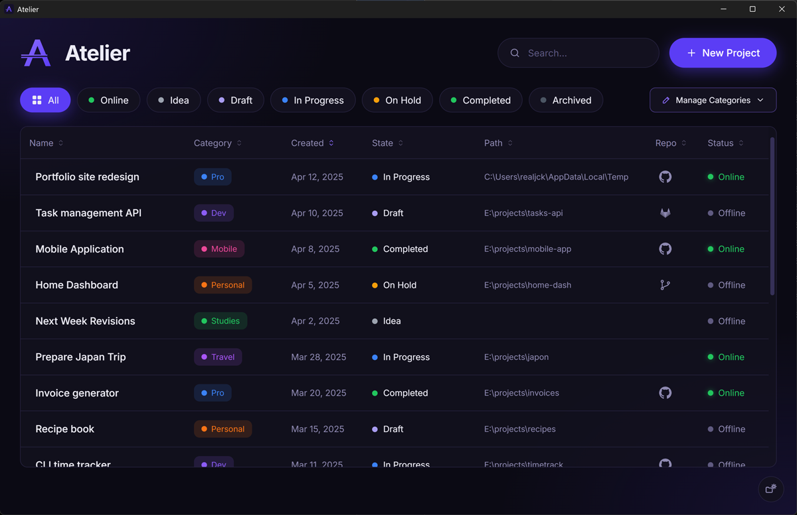

# Atelier

A desktop tool for keeping track of personal projects: where each one lives on disk, where its
repository is, and whether it is online, all one click away.



Built with Tauri 2 (Rust + SQLite) and React + TypeScript.

## Features

- **Projects** with a name, category, creation date, state (Idea, Draft, In Progress, On Hold,
  Completed, Archived), local folder, repository URL and production URL. A project with a
  production URL is shown as Online.
- **One-click access**: open the folder in File Explorer, the repository (GitHub, GitLab or
  other) or the live site in the browser.
- **Priority**: every project has a unique rank, new projects start at #1. Sort by the `#`
  column to reorder by drag and drop; the list auto-scrolls near its edges. Names are
  larger, bolder and brighter the higher their priority.
- **Filters, search and sorting**. Archived projects are hidden unless the Archived filter
  is selected.
- **Categories** with colors, managed on the fly from the Manage Categories panel.
- **Light and dark themes**: follows the OS theme until you flip the switch in the
  bottom-right corner; the choice is then remembered.
- **Local data**: a single SQLite file (`%APPDATA%\com.atelier.app\atelier.db`), whose folder
  opens from the gear button in the bottom-right corner.

## Development

Requires Node.js 22+ and Rust stable (see [Tauri prerequisites](https://tauri.app/start/prerequisites/)).

```sh
npm install
npm run tauri dev     # run the app on atelier-dev.db, a copy of atelier.db made on first launch
npm test              # UI tests
npm run lint          # type check
cargo test --manifest-path src-tauri/Cargo.toml   # data layer tests
npm run tauri build   # installers in src-tauri/target/release/bundle/
```
